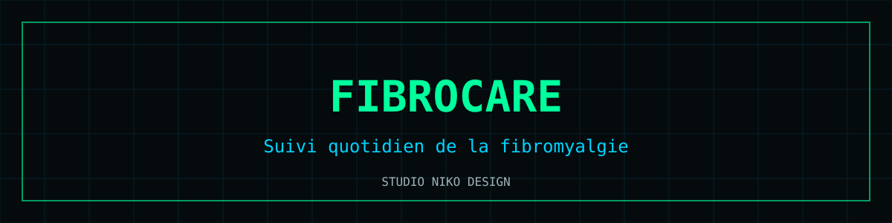
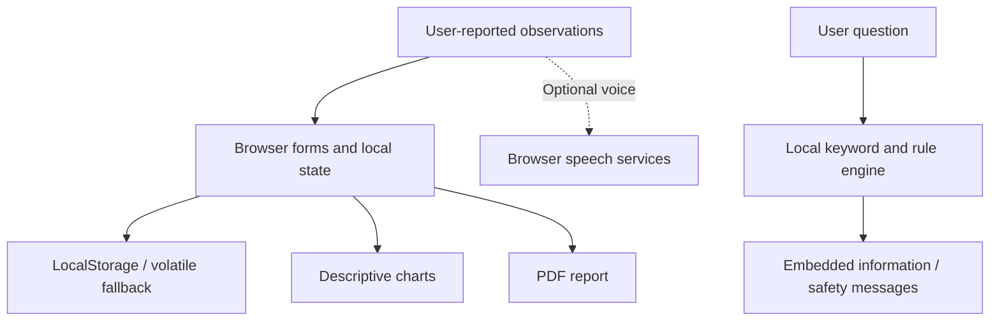

# FibroCare V7 — Studio Niko Design

**A browser-based fibromyalgia symptom diary and experimental self-management information workspace.**

Un journal personnel pour consigner les symptômes déclarés, observer leur évolution et préparer une consultation, sans interprétation clinique automatique validée.

  

**STUDIO NIKO DESIGN** · Build smart. Stay lightweight. Create without limits.

[Démo existante (disponibilité non vérifiée)](https://nikoju1977.github.io/fibrocare/) · [English overview](#english-overview) · [Quickstart](#quickstart--démarrage-rapide)

> Démonstration et qualification : données fictives uniquement. Aucun GIF ni résultat de test n'est revendiqué.

> **Prototype non validé cliniquement.** Ne pas utiliser pour une décision médicale, un diagnostic, une prescription ou une urgence. En France, danger immédiat : 15 ou 112. Inspection statique de sources uniquement ; aucun nouveau test, audit de sécurité, appel réel fournisseur, essai sur appareil ou validation clinique n'a été réalisé pour ce README.

## Fiabilisation fonctionnelle — 25 novembre 2026

[Correctif source](https://github.com/Nikoju1977/fibrocare/commit/9f3b3c58582d5d1e17038bba589ea512e71eb1c7). Le journal et les modules existants sont conservés. Les éléments historiques ci-dessous décrivent les limites antérieures lorsqu'ils mentionnent l'ancien export ou la pagination absente.

- Sauvegarde des cinq rubriques (symptômes, médicaments déclarés, rendez-vous, contacts, messages locaux) via AES-GCM 256, dérivation PBKDF2 SHA-256 à 600 000 itérations, sel et IV aléatoires. Conversations et préférences du bot non incluses.
- Restauration chiffrée avec validation de structure, vérification des écritures et tentative de restauration de l'état précédent en cas d'échec. Ancien format non importé. L'effacement n'appelle plus `localStorage.clear()` ; il cible les cinq clés historiques du journal, lesquelles ne sont pas isolées par application sur une origine partagée.
- PDF avec retours à la ligne, pagination, numéros de page et conservation du score zéro. Graphiques triés par date.
- 12 assertions JavaScript de validation des entrées ont réussi lors de la rédaction du correctif. Commit et empreinte de source relus. Aucun test navigateur, crypto bout en bout, PDF réel, mobile ni déploiement n'est revendiqué.
- Stockage courant encore en clair ; le PDF est également en clair. La phrase secrète est demandée par une boîte de dialogue navigateur non masquée : amélioration requise. Le contenu médical embarqué reste à revoir ; données fictives exclusivement avant qualification.

## Pourquoi ce projet ?

Mettre à disposition une interface légère qui distingue les observations de la personne des informations générales. L'assistant intégré exploite des règles et une base documentaire, pas un médecin virtuel ni un LLM dont l'inférence serait démontrée.

## Fonctionnalités clés

- 📓 Journal des symptômes, douleur, énergie, traitements déclarés, rendez-vous et contacts.
- 📊 Graphiques descriptifs des sept derniers relevés de douleur et d'énergie via Chart.js.
- 📄 Rapport PDF local via jsPDF ; import/export JSON chiffré du journal (implémenté, tests navigateur à réaliser).
- 📚 Assistant documentaire par mots-clés, règles et réponses prédéfinies ; messages de communauté locale, sans réseau social démontré.
- 🎙️ Dictée et synthèse vocale selon navigateur et permissions ; tentative de cache PWA, installation non validée.

## Architecture & algorithmes

| Composant (`index.html`) | Fonction constatée |
| --- | --- |
| `db.get`, `db.set`, `db.add` | Lecture/écriture JSON via façade de stockage synchrone. |
| `renderChart` | Sept derniers relevés, séries descriptives douleur et énergie. |
| `searchFibrobotKnowledge`, `getFibrobotResponse` | Recherche par mots-clés et réponses documentaires, sans validation clinique ni inférence LLM établie. |
| `generatePDF` | Transcription des observations dans un document PDF non chiffré. |

**Risques cliniques :** les fiches embarquées comprennent des informations posologiques et des recommandations de traitements et compléments non revues pour cette version. Elles ne constituent pas une prescription ni des conseils individualisés. Les règles d'urgence sont heuristiques et non exhaustives. Les symptômes et graphiques ne démontrent aucune causalité et ne permettent pas de diagnostiquer une maladie. Ne pas utiliser ce prototype pour décider d'un médicament, d'une dose ou d'une urgence.

## Confidentialité et sécurité

- `safeStorage` est une façade de `localStorage` avec repli mémoire ; le commentaire AES-256-GCM dans le fichier ne correspond pas au mécanisme actif. Les données sont en clair au repos. Le repli mémoire peut perdre des données à la fermeture.
- L'ancien export JSON sérialisait la façade de stockage ; le nouveau exporte explicitement les cinq rubriques, avec restauration à qualifier. Ne pas utiliser comme unique sauvegarde. Le PDF contient des informations de santé en clair.
- Chart.js 4.4.0, jsPDF 2.5.1 et Google Fonts sont chargés depuis des CDN. Les bibliothèques s'exécutent dans la page ; la reconnaissance vocale peut dépendre d'un service distant. Pas de garantie de traitement 100 % local ni d'absence de flux réseau.
- Le service worker est tenté via une URL Blob ; l'installation et le fonctionnement hors ligne ne sont pas établis. Une boîte de consentement ne suffit pas à prouver la conformité RGPD.

## Cadre médical et réglementaire

Les références à la qualité des dispositifs médicaux (ISO 13485), au cycle de vie logiciel (IEC 62304), à la gestion des risques (ISO 14971) ou à la protection des données (RGPD) sont des pistes de qualification selon l'usage prévu, et non des déclarations de conformité. L'applicabilité réglementaire doit être évaluée par des spécialistes. Aucune validation clinique, certification, autorisation de mise sur le marché ni conformité à FDA 21 CFR Part 11 n'est démontrée.

## Quickstart / Démarrage rapide

Cloner le dépôt et servir sa racine avec `python3 -m http.server 8000`, puis ouvrir http://localhost:8000/. Essayer uniquement avec des données fictives, vérifier le graphique et le PDF. Ne pas saisir de données médicales réelles dans ce prototype non qualifié.

## Qualification proposée — journal et confidentialité

**Usage prévu de cette démonstration :** consigner et visualiser des observations fictives. Les informations thérapeutiques embarquées ne sont pas validées pour cette version ; leur retrait ou revue par des professionnels est prioritaire. Ce README ne modifie pas les recommandations affichées dans l'application.

| Contrôle proposé (non exécuté) | Critère attendu |
| --- | --- |
| Journal | Ajouter, modifier et supprimer des observations fictives ; vérifier leur restitution fidèle |
| Graphiques | Vérifier la correspondance entre les sept relevés et les séries, sans inférence clinique |
| PDF | Comparer le rapport à l'intégralité des données fictives ; vérifier la pagination, le texte et les valeurs manquantes |
| Sauvegarde JSON | Vérifier que tous les enregistrements sont effectivement exportés puis restaurés ; corriger avant de compter sur cette fonction |
| Confidentialité | Vérifier le stockage, les transmissions, le consentement et la suppression ; ne pas utiliser de données de santé réelles |
| Informations médicales | Retirer les posologies non qualifiées ; faire vérifier les contenus et les messages d'orientation |

La pagination et le retour à la ligne sont désormais codés, ainsi que la sauvegarde explicite des cinq rubriques. Leur fonctionnement complet reste à vérifier. Le stockage actif n'est pas chiffré.

**English:** Proposed checks cover descriptive records, chart fidelity, report completeness, backup recovery and privacy. Use synthetic data only. Treatment content and unencrypted storage require remediation. No new tests or clinical review were carried out.

## Roadmap & contribution

Propositions non terminées :

- [ ] Priorité : retirer les recommandations posologiques non validées et faire relire les fiches par des professionnels.
- [ ] Mettre en place un coffre chiffré avec migration consentie, sauvegarde et restauration vérifiées.
- [ ] Corriger l'export JSON et tester les erreurs, les données corrompues et la suppression.
- [ ] Auditer les dépendances, les flux vocaux, la PWA et l'accessibilité.

**Première contribution / `good first issue` (label proposé, non créé ici) :** Ajouter un test de sauvegarde/restauration à partir d'observations entièrement fictives.

Les contributions ciblées sous MIT sont bienvenues. [Issues](https://github.com/Nikoju1977/fibrocare/issues) pour les sujets non sensibles. Ne jamais publier de données de santé, de captures personnelles, de clés API ou de détails exploitables de vulnérabilité. Contacter le mainteneur en privé pour les problèmes de sécurité.

## English overview

FibroCare is an experimental symptom diary with descriptive charts, PDF reports and rule-based information. The active storage is unencrypted localStorage, not an AES-GCM vault. JSON backup completeness is not established. External CDN and browser speech services prevent a blanket offline/privacy claim. Embedded treatment information is not clinically reviewed for this release. Do not use it for diagnosis, prescription or emergency decisions. Use synthetic data only until the prototype is qualified.

No new runtime, security or clinical validation was performed in this documentation revision.

## Licence & auteur / License & author

[MIT](LICENSE) © 2026 Nicolas Julienne — Studio Niko Design. Les droits et mentions des dépendances tierces restent applicables. Contributions sous la licence existante. Aucun fichier de licence n'a été modifié.

[Studio Niko Design — Portfolio](https://github.com/Nikoju1977)
